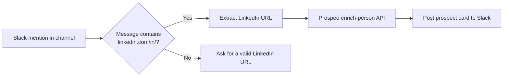

# AI SDR Agent

Slack-native prospect enrichment for SDR and GTM teams.

When someone mentions the bot in Slack with a LinkedIn profile URL, this n8n workflow validates the URL, enriches the person through [Prospeo](https://prospeo.io/), and posts a structured contact card back into the channel.

Built as a live GTM operations workflow, not a demo chatbot.

## Why it exists

SDRs often drop LinkedIn links in Slack and then leave the channel to look up email, mobile, title, and company. This workflow keeps that work in Slack:

- Catch a LinkedIn URL from a Slack mention
- Reject invalid messages with a clear prompt
- Enrich the person (email, mobile, title, company, location)
- Post a readable prospect card the team can act on immediately

## How it works



1. **Trigger** — Slack app mention in the target channel.
2. **If** — checks that the message contains `linkedin.com/in/`.
3. **Enrichment** — `POST https://api.prospeo.io/enrich-person` with the parsed LinkedIn URL and mobile enrichment enabled.
4. **Reply** — posts name, job title, company, email + status, location, LinkedIn URL, and mobile + status.
5. **Invalid URL** — replies `Please provide a valid linkedin url.` when the mention has no profile link.

## What a recruiter will see in the workflow

| Node | Type | Role |
| --- | --- | --- |
| Trigger | Slack Trigger | Starts on `@mention` |
| If | If | Guards against non-LinkedIn messages |
| Enrichment | HTTP Request | Calls Prospeo person enrichment |
| Reply | Slack | Formats and sends the prospect card |
| Invalid url | Slack | User-facing validation message |

Skills this project demonstrates:

- GTM / SDR operations design (intake → enrich → hand back to the team)
- n8n workflow orchestration
- Slack bot triggers and channel replies
- REST API integration and JSON payload mapping
- Input validation and failure messaging
- Parsing LinkedIn URLs out of Slack message markup

## Import into n8n

1. In n8n: **Workflows → Import from file**.
2. Select [`workflows/ai-sdr-agent.json`](workflows/ai-sdr-agent.json).
3. Attach a **Slack** credential on `Trigger`, `Reply`, and `Invalid url`.
4. Add your Prospeo API key to the `Enrichment` node header `X-KEY` (or move it into an n8n credential / header auth).
5. Set the Slack channel on the trigger and reply nodes.
6. Publish / activate the workflow so Slack mentions start runs.

API keys are not stored in this repository.

## Example Slack reply

```
🎯 Prospect Enriched Successfully

👤 Name: Jane Doe
💼 Job Title: Head of Demand Generation
🏢 Company: Example GmbH
📧 Email: jane.doe@example.com
Status: valid
📍 Location: Berlin, Germany
🔗 LinkedIn: https://www.linkedin.com/in/janedoe
Mobile: +49 ...
Status: valid
```

## Setup notes

- Slack app needs mention events and permission to post in the target channel.
- Prospeo account needs access to person enrichment (email + mobile).
- Slack wraps links in angle-bracket markup (`<https://linkedin.com/in/handle|label>`). The enrichment node strips that markup before calling Prospeo.

## Security

Do not commit Prospeo keys or Slack tokens. Keep them in n8n credentials or environment variables.

## Author

**Hrishikesh Puri** — Engineering Management (BSBI), Berlin  
Demand generation, campaign ops, and marketing analytics  

- GitHub: [hrishikeshpuri](https://github.com/hrishikeshpuri)
- LinkedIn: [hrishikesh-puri-52688b148](https://www.linkedin.com/in/hrishikesh-puri-52688b148/)
